  

  

  
  
  

  
  
  

  

I'm a **BS Artificial Intelligence student at FUUAST Islamabad**, building my skills through coursework and hands-on projects.

I enjoy turning ideas into working software: understanding the problem, planning a clean solution, and improving it step by step. Right now I'm focused on **C++ and object-oriented programming**, **Python**, **databases (SQL / SQL Server)**, and the fundamentals of **AI and machine learning**.

  

  

**BS Artificial Intelligence** (in progress)
Federal Urdu University of Arts, Science and Technology (FUUAST), Islamabad

Completed SSC and HSSC.

<!-- TODO (optional): add CGPA, graduation year, or verified certificates here once you have proof. -->

  

  

Source code and more work: [**github.com/Haris98-Luka?tab=repositories**](https://github.com/Haris98-Luka?tab=repositories)

<!-- TODO: replace the link above with a direct repository link for each project in the table, e.g. [Student Management System](https://github.com/Haris98-Luka/REPO-NAME) -->

  

**Programming and tools**

  

**Databases**

  
  

**Also working with**

  
  
  

<!-- NOTE: Graphic Design, Video Editing and MS Office have no proof in the repositories. Keep them only if you can show work (a portfolio link, samples) or are happy to list them as general skills. -->

  

  
  

  

  

  

  

  

  

  

  
  
  

  

