  
 
  
 
    
 
   

About

I'm a BS Artificial Intelligence student at FUUAST Islamabad, building my skills through coursework and hands-on projects.

I enjoy turning ideas into working software: understanding the problem, planning a clean solution, and improving it step by step. Right now I'm focused on C++ and object-oriented programming, Python, databases (SQL / SQL Server), and the fundamentals of AI and machine learning.

	
Studying	BS Artificial Intelligence, FUUAST Islamabad
Interests	Artificial Intelligence, Machine Learning, Software Development, Problem Solving
Currently	Building practical software projects and strengthening my fundamentals
Open to	Collaborations, learning opportunities, internships
Education

BS Artificial Intelligence (in progress) Federal Urdu University of Arts, Science and Technology (FUUAST), Islamabad

Completed SSC and HSSC.

<!-- TODO (optional): add CGPA, graduation year, or verified certificates here once you have proof. -->
Selected Projects
Project	What it is	Stack
Student Management System	Console application for managing student records through modular classes, with input validation and CRUD-style workflows.	C++ · OOP
Scholarship Eligibility System	Rule-based system that decides scholarship eligibility using academic, extracurricular, community-service and financial criteria.	C++ · OOP
LoadShedding Project	Multi-class simulation of power-demand management with Area, PowerStation, WeatherSystem and Controller components.	C++ · OOP · Header files
Smart Exam Cheating Detector	Concept / prototype exploring how computer vision can assist in spotting suspicious behaviour during exams.	Python · Computer vision (concept)
Online Complaint Management System	Multi-class system for submitting, managing and tracking complaints with role-based workflows.	C++ · OOP

Source code and more work: github.com/Haris98-Luka?tab=repositories

<!-- TODO: replace the link above with a direct repository link for each project in the table, e.g. [Student Management System](https://github.com/Haris98-Luka/REPO-NAME) -->
Skills

Programming and tools

  

Databases

   

Also working with

    
 <!-- NOTE: Graphic Design, Video Editing and MS Office have no proof in the repositories. Keep them only if you can show work (a portfolio link, samples) or are happy to list them as general skills. -->
GitHub Stats

   
 
  

Contribution Activity

  

Contribution Snake

  

Current Focus
Learning	Building
Artificial Intelligence and Machine Learning	Practical software projects
Data structures and algorithms	Clean, modular C++ and Python programs
Object-oriented design	Small tools that solve real problems
SQL and database fundamentals	Better Git and GitHub habits
Connect

   
 <!-- TODO: add your real LinkedIn / LeetCode / HackerRank profile URLs here if you have them. Generic homepage links were removed. --> 
  

